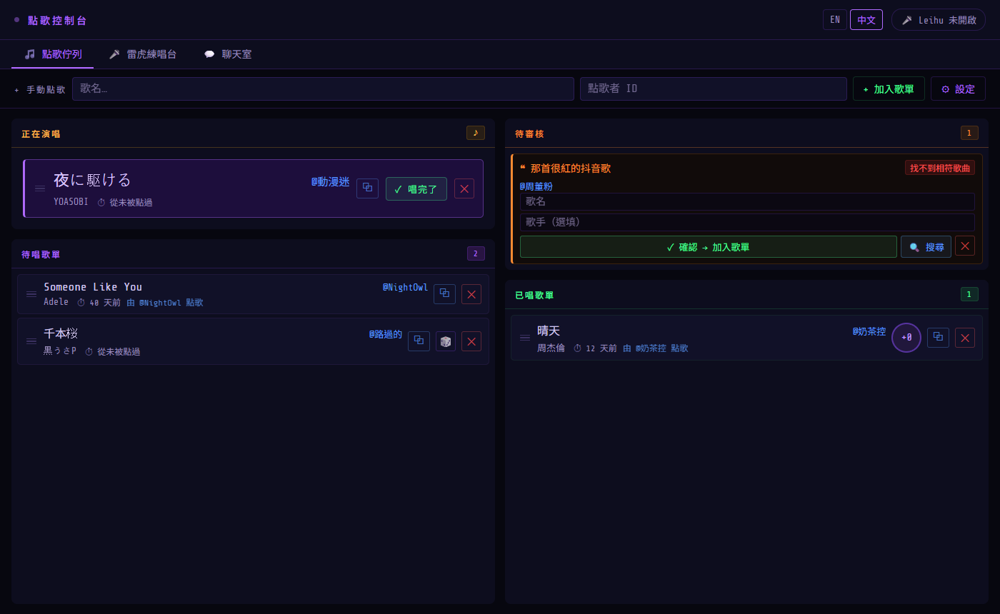
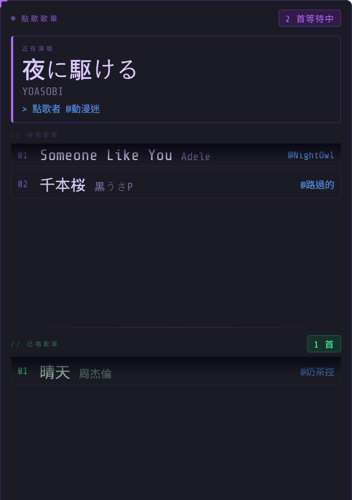

# 🎵 VTuber 點歌系統

給 Twitch 實況主的點歌系統：觀眾用頻道點數點歌，歌單顯示在直播畫面上，你在一個控制台裡管理點歌、聊天室和直播場景。
在你自己的電腦上執行，免費、開放原始碼。

**[English](README_EN.md)** · **[新手入門（從零開始）](docs/STARTER_GUIDE_zh_TW.md)** · **[下載最新版本](https://github.com/sheng7337/twitch-song-request-system/releases/latest)** · **[更新紀錄](CHANGELOG.md)**



---

## 可以做什麼

### 🎵 頻道點數點歌
- 觀眾兌換「點歌」並打上歌名，系統會比對你 Google 試算表裡的歌單：完全相同、打錯字、羅馬拼音、假名都找得到。
  找不到的歌先放到「待審核」，由你決定。
- **隨機點歌**獎勵：可以只從某個分頁抽（例如「隨機日語歌」），最近唱過的歌會冷卻幾天；很久沒被點的歌比較容易抽到。
- 每首歌記錄上次被點的時間和點歌的人，卡片上直接看得到；直播中重新啟動也不會弄丟歌單。
- 在控制台勾選哪些分頁可以被點、被抽（還在練的歌放在「待練勿點」就不會被點到，但雷虎練唱台照樣會準備）。



### 🎤 雷虎練唱台（選用）
搭配 [雷虎練唱台 Leihu Singsing](https://github.com/LeihuTW/Leihu-singsing)：從 YouTube 做出伴奏和時間軸歌詞。
- 點歌進來可以自動準備伴奏，按「**🎤 練唱**」直接在雷虎練唱台打開這首歌，連 KEY 都調好。
- 雷虎練唱台的畫面就在控制台的分頁裡；也可以一次準備整份歌單，並替歌單找好 YouTube 連結。

### 💬 聊天室
- 每個分頁旁邊都有即時聊天室：搜尋、篩選、看之前的直播。要感謝或打招呼的事件（第一次發言、訂閱、小奇點、揪團、兌換）會標出來。
- 直接在控制台發言、回覆、封鎖／禁言、Shoutout、揪團、置頂訊息，以及完成或退還兌換。
- **直播畫面上的聊天室**（取代 OneComme）：四種樣式，有 Twitch 徽章和表情符號；被刪除的訊息會立刻消失。


### 🔔 通知
取代 Streamlabs 的 Alert Box：追隨、訂閱、贈訂、小奇點和揪團，一次一則，用疊加層的主題和語言。
- 每一種都可以設定開關、最低門檻、顯示多久，以及 `alert-media` 資料夾裡的圖片、GIF、影片和音效（沒有的話用內建的提示音）；全部共用一個預設音效，也可以各自選。每個音效檔會自動調成一樣大聲。
- 到達一定數量就顯示**大型通知**（例如 50 人以上的揪團）；一次送出多份訂閱只顯示一則。
- 「**▶ 測試**」只顯示在直播畫面上，不會發到 Twitch。


**🎟️ 兌換特效**（取代 TriggerFyre）：觀眾兌換頻道點數時播放音效、圖片／GIF／影片，放在畫面上你指定的位置。
- 一個兌換項目可以放好幾個音效，每次隨機播一個；可以顯示兌換的人和他打的字。
- 播完自動把兌換標成完成；沒有播的（關閉、跳過、排隊已滿）會退還點數。
- 模式可以暫停特效（例如唱歌時），之後再依序播放。

### 🎛 模式
「🎤 唱歌」「💬 聊天」「☕ 休息」……按一下就設定好 Streamlabs Desktop 或 OBS：場景、要顯示哪些來源、位置和音訊；
還可以暫停 Clip、在聊天室發一則訊息、切換控制台分頁。

### 🎬 Clip、感謝名單與揪團
- `!so` 送出 Shoutout 並播放對方的 Clip；`!watch` 播放 Twitch Clip 或 YouTube。
- `!tk` 感謝名單、`!endingtk` 片尾名單：揪團、訂閱、小奇點、新追隨、兌換、點歌和最活躍的觀眾。
- **搭配片尾名單揪團**：系統算好時間播片尾名單，名單結束 10 秒後剛好出發。

### 🎭 情境點歌
觀眾寫下心情，Claude（Anthropic 的 AI）從你的歌單挑一首，並寫一句要發到聊天室的話（中文和英文）。你看過才會送出。
使用你自己的 Anthropic API 金鑰（每次選歌約 0.01–0.05 美元）。

### 🤖 聊天機器人（取代 Nightbot）
自己的指令（`!歌單` → 歌單試算表連結），有變數和冷卻時間；定時訊息會等聊天室有人講話才發。用你的帳號發言。

### 📱 提詞機
在防噴罩後面的平板上看雷虎練唱台正在播的歌詞和聊天室。

### 👕 換裝（veadotube mini）
觀眾兌換獎勵後跳出卡片，點一下要穿的衣服；可以設定幾分鐘後換回預設服裝。

### ☕ 休息中／準備中卡片
放在直播畫面上的倒數卡片，網址加上 `?min=10` 或 `?at=20:00` 就會倒數。


### 🎨 主題和文字大小
五種主題（霓虹、日光、高對比、海洋、奶油咖啡），控制台和疊加層可以分開選，文字大小也可以調，版面不會跑掉。
控制台在手機上也能用，中英文介面。


---

## 需要什麼

- Windows 電腦，以及 [Node.js LTS](https://nodejs.org)
- Twitch 帳號（要開啟雙重驗證，才能建立 Twitch 應用程式）
- Google 帳號：歌單放在 Google 試算表
- OBS Studio 或 Streamlabs Desktop
- 選用：[雷虎練唱台](https://github.com/LeihuTW/Leihu-singsing)、veadotube mini

---

## 開始使用

**第一次用、還沒有歌單？** 從 [新手入門（從零開始）](docs/STARTER_GUIDE_zh_TW.md) 開始 —— 不需要會寫程式。

**首次安裝**：安裝 [Node.js LTS](https://nodejs.org)，然後雙擊 `start_zh.bat`，跟著瀏覽器的安裝精靈走即可。

**每次直播**：雙擊 `start_zh.bat`，就這樣。控制台在 `http://localhost:3000/dashboard`。

**更新到新版本**：到[最新版本](https://github.com/sheng7337/twitch-song-request-system/releases/latest)先看「⚠ 需要動手」，再照[新手入門第 12 章](docs/STARTER_GUIDE_zh_TW.md#12-更新到新版本)的步驟 —— 你的設定不會被覆蓋。

> 每個分頁怎麼用：[docs/README_zh_TW.md](docs/README_zh_TW.md)。安裝和設定：[SETUP_zh_TW.md](SETUP_zh_TW.md)；不用安裝精靈的手動設定見 [SETUP_MANUAL.md](SETUP_MANUAL.md)。

---

## OBS 瀏覽器來源

控制台最上面的「**🎨 外觀與疊加層**」列出每一個網址和大小，可以直接「**複製**」。

| 來源 | 網址 | 尺寸 |
|---|---|---|
| 歌單 | `http://localhost:3000/overlay/index.html` | 960×1470，在場景裡縮小到 50%（480×735） |
| Clip 播放器 | `http://localhost:3000/clip-player/index.html` | 1920×1080 |
| 聊天室 | `http://localhost:3000/overlay/chat.html?style=panel`（或 `bubble`、`list`、`row` 橫向一排） | 例如 960×1080（`row`：3840×200），縮小到 50% |
| 通知 | `http://localhost:3000/overlay/alerts.html?layout=vertical`（或 `horizontal` 圖在左） | 800×600（`horizontal`：1600×300），縮小到 50% |
| 兌換特效 | `http://localhost:3000/overlay/reward-effects.html` | 1920×1080，蓋住整個場景 |
| 休息中卡片 | `http://localhost:3000/overlay/break.html` | 960×260，縮小到 50% |
| 準備中卡片 | `http://localhost:3000/overlay/break.html?card=opening` | 960×260，縮小到 50% |

歌單的自訂 CSS：
```css
body { background-color: rgba(0, 0, 0, 0) !important; margin: 0px auto; overflow: hidden; }
```

---

## 聊天指令（版主／台主限定）

| 指令 | 說明 |
|---|---|
| `!so <帳號>` | 送出 Twitch 的 Shoutout，播放指定頻道的隨機 Clip，並記錄到感謝名單 |
| `!tk` | 播放感謝名單，列出本場所有 `!so` 的頻道 |
| `!endingtk` | 片尾感謝名單：揪團、訂閱、小奇點、新追隨、兌換、點歌和最活躍的聊天觀眾 |
| `!watch <網址>` | 播放 Twitch Clip、YouTube 或影片連結 |
| `!replay` | 重播上一個片段 |
| `!stop` | 立即停止目前的播放 |

**感謝名單的背景圖**：把圖片（jpg／png／gif／webp）放進 `clip-player/sponsor-bgs/`，可以放很多張，每次隨機選一張；
重新啟動後生效。資料夾裡沒有圖片時，背景是深色。

---

## 授權 / License

[MIT](LICENSE)。雷虎練唱台（Leihu Singsing）是另一個軟體，有它自己的授權。
