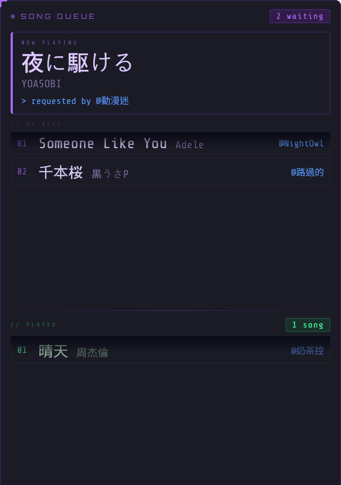
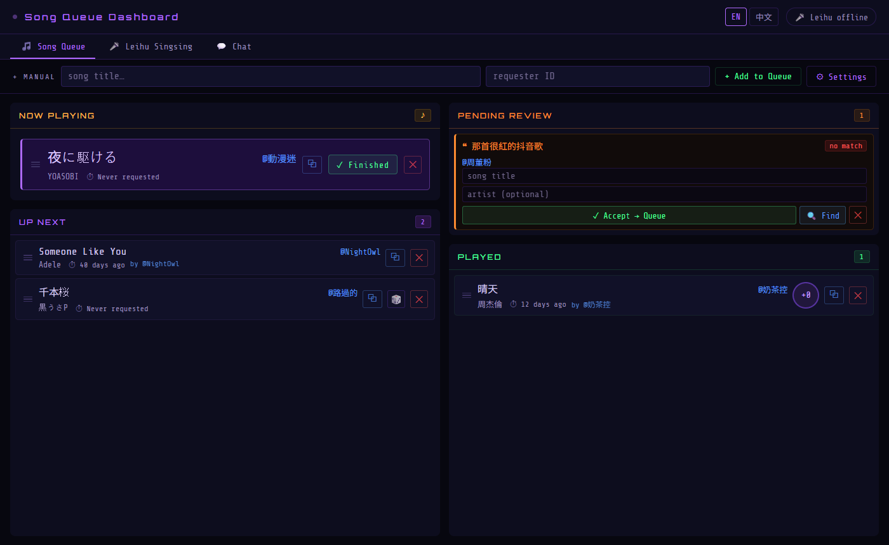
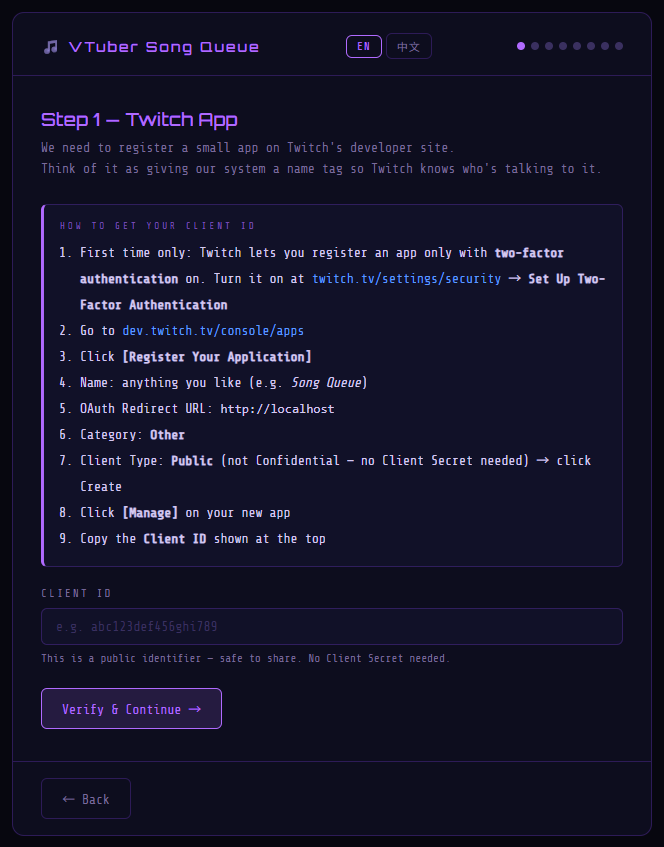
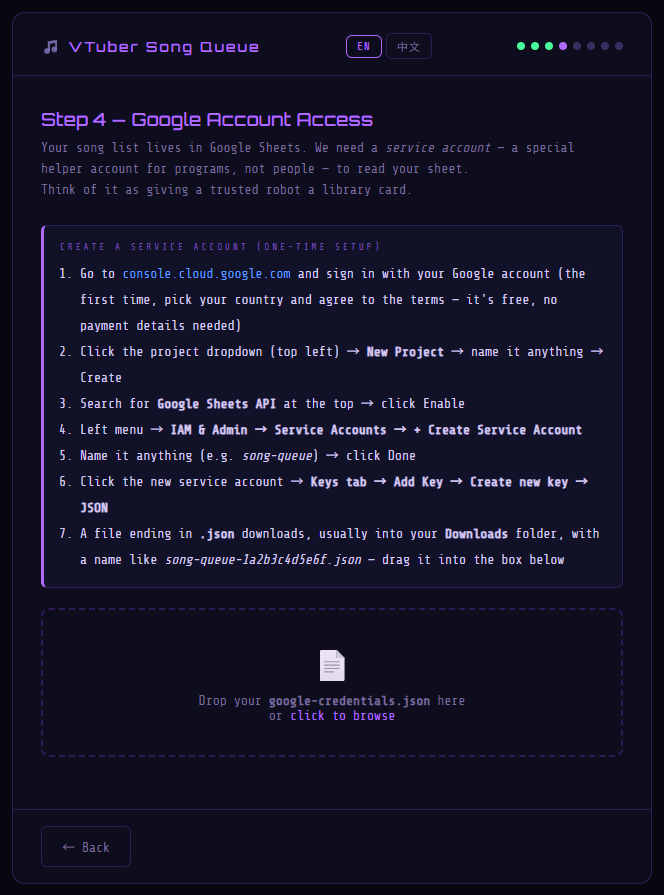
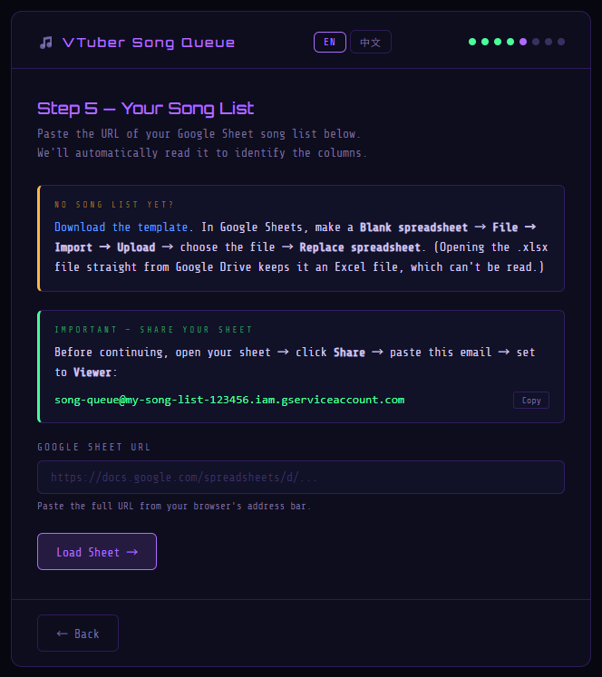
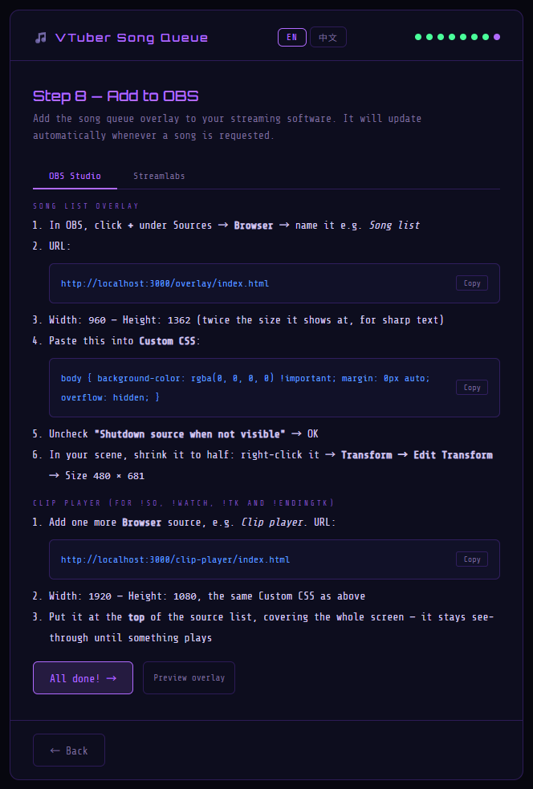
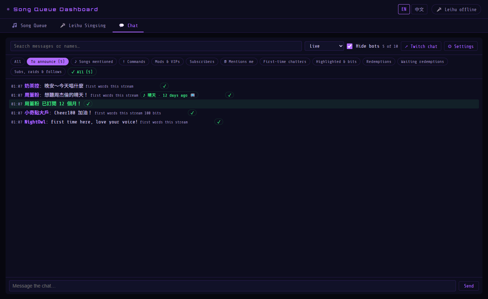

# 🎵 VTuber Song Queue — Starter Guide (from scratch)

This guide is for streamers who have **never used** this system: no programming, no command line,
and you don't need a song list yet. Follow it in order, and in about **an hour** your viewers can
request songs with Channel Points.

> 中文版：[STARTER_GUIDE_zh_TW.md](STARTER_GUIDE_zh_TW.md)

---

## Contents

1. [What it does](#1-what-it-does)
2. [What you need](#2-what-you-need)
3. [Turn on Twitch two-factor authentication](#3-turn-on-twitch-two-factor-authentication)
4. [Install Node.js](#4-install-nodejs)
5. [Download the song queue](#5-download-the-song-queue)
6. [Make your song list](#6-make-your-song-list)
7. [Run the setup wizard](#7-run-the-setup-wizard)
8. [Add it to OBS](#8-add-it-to-obs)
9. [Test before going live](#9-test-before-going-live)
10. [Every stream](#10-every-stream)
11. [Extras (optional)](#11-extras-optional)
12. [Updating to a new version](#12-updating-to-a-new-version)
13. [When something goes wrong](#13-when-something-goes-wrong)

---

## 1. What it does

Viewers redeem a **Song Request** with Channel Points and type a title. The system finds the song in
your list and adds it to the song list on your stream. On the **dashboard** you press **✓ Finished**
and the next song comes up.



- **Song Request**: viewers type a title; the system matches it even with typos, part of the title, or
  Japanese typed in romaji. Requests it isn't sure about wait in **Pending Review** for you.
- **Random Song**: no typing; the system picks a song from your list (avoiding ones sung recently).
- **Dashboard**: the queue, your chat and channel-point redemptions, on one page.
- Everything runs **on your own PC**: no server to rent, nothing to pay.



---

## 2. What you need

| You need | Notes |
|---|---|
| A **Windows** PC | The one you stream from |
| A **Twitch account** with **Channel Points** | In the [Creator Dashboard](https://dashboard.twitch.tv) → Viewer Rewards → Channel Points, you can manage rewards |
| A **Google account** | Your song list lives in Google Sheets. Use a **personal Gmail**: work or school accounts are often restricted |
| **OBS** or **Streamlabs** | What you already stream with |
| Your phone | For Twitch two-factor authentication |

Everything is **free**; no credit card needed.

---

## 3. Turn on Twitch two-factor authentication

The song queue registers a small app on Twitch, and **Twitch only allows that with two-factor
authentication on**. Skip this if yours is already on.

1. Open [twitch.tv/settings/security](https://www.twitch.tv/settings/security) (Settings → Security and Privacy)
2. Under **Two-Factor Authentication**, click **Set Up Two-Factor Authentication**
3. Finish it on your phone (text message or an authenticator app)

---

## 4. Install Node.js

Node.js is what the song queue runs on. You install it once.

1. Open [nodejs.org](https://nodejs.org) and download the **LTS** version (Windows Installer)
2. Run it and keep **all the defaults**: Next, Next… Install
3. **Restart your PC** once afterwards, so Windows finds it

> If the installer offers "Tools for Native Modules", **leave it unticked**.

---

## 5. Download the song queue

1. Download this file: [**the song queue (ZIP)**](https://github.com/sheng7337/twitch-song-request-system/archive/refs/heads/master.zip)
2. Right-click the ZIP → **Properties**. If there's an **Unblock** box at the bottom, tick it → OK
   (so Windows doesn't warn you every time you start it)
3. Right-click the ZIP → **Extract All** → pick a simple place, e.g. `C:\SongQueue`

> **Not** in a OneDrive-synced folder (on many PCs, Desktop and Documents sync to OneDrive). This
> folder will hold your account keys, which shouldn't go to the cloud.

The folder should contain `start.bat`, `setup` and so on.

---

## 6. Make your song list

Your song list is a **Google Sheet**. The system reads it every 5 minutes, so songs you add later show
up without restarting anything.

### 6-1. Start from the template

1. Download the template: [**song-list-template.xlsx**](https://github.com/sheng7337/twitch-song-request-system/raw/master/docs/song-list-template.xlsx)
   (it's also in the folder you extracted: `docs\song-list-template.xlsx`)
2. Open [sheets.new](https://sheets.new) (a new blank Google Sheet)
3. **File → Import** → **Upload** → drop the template in
4. Import location: **Replace spreadsheet** → **Import data**
5. Click "Untitled spreadsheet" at the top left and give it a name, e.g. "My song list"

> ⚠ Don't upload the .xlsx to Google Drive and open it from there: it stays an **Excel file**, and the
> song queue can't read it. Use **Import** as above.

### 6-2. The format

The template has 4 tabs: **國語** (Mandarin), **日語** (Japanese), **English** and **待練勿點**. Row 1
of each tab holds the column names:

| title | artist | key | YTLink |
|---|---|---|---|
| Someone Like You | Adele | | |
| Let It Go | Idina Menzel | -3 | |

- **title** and **artist**: **required**. Requests are matched against these
- **key** (optional): the key you sing it in, in semitones from the original, e.g. `2` or `-3`. Shown on
  the dashboard as a reminder. Leave empty if you don't need it
- **YTLink** (optional): the song's YouTube link, for backing tracks with Leihu Singsing
  (see [Extras](#11-extras-optional)). Leave empty otherwise
- **Tabs**: sort songs however you like; rename tabs or add new ones. A random reward can draw from one
  tab only (e.g. "Random Japanese song")
- **The 待練勿點 tab** (Chinese for "still practising — don't request"): songs here **can't be requested**.
  Keep that exact name; it's the one tab left out by default

The songs in the template are examples: **replace them with yours** before going on.

### 6-3. Already have a list? Bring it over

- **In Excel**: import your Excel file the same way as 6-1, then arrange it into a title column and an
  artist column (the names don't have to be title / artist: the wizard asks you to click which is which)
- **Title and artist in one cell** (e.g. "Someone Like You - Adele"): select that column → **Data →
  Split text to columns** → Separator: **Custom** → type ` - `
- **In a text file or document**: copy it all, paste into column A (one song per row), then split as above
- **A table on a web page or in Notion**: copying the table and pasting it into the sheet usually keeps the columns

> One song per row. The same title by different artists (covers) can be separate rows: they count as different songs.

---

## 7. Run the setup wizard

1. Open the song queue folder and **double-click `start.bat`** (`start_zh.bat` for Chinese)
   - A black window opens. The first time, it takes a minute or two to download what it needs (internet required)
   - If Windows shows "Windows protected your PC" or a security warning: **More info → Run anyway**, or **Run**
2. Your browser opens the **setup wizard**. If it doesn't, open <http://localhost:3000>
3. **Leave the black window open**: it *is* the song queue. Closing it stops it

Every wizard step explains itself. These are the places people get stuck:

### Step 1 — Twitch app



- Two-factor authentication (point 1) is [chapter 3](#3-turn-on-twitch-two-factor-authentication); skip it if done
- For "OAuth Redirect URLs", type `http://localhost` and click **Add**
- Client Type must be **Public**
- After **Create**, click **Manage** on your app and copy the **Client ID** at the top into the wizard

### Step 2 — Connect your channel

You'll get a short code: enter it at **twitch.tv/activate** and click **Authorize**. The browser must be
**signed in to the Twitch account you stream on**, not an alt.

### Step 3 — Channel Points rewards

Choose **Create a new reward... (recommended)**, give it a name and a cost (e.g. Song Request 500,
Random Song 300). You can change the cost on Twitch later.

### Step 4 — Google account access



Here you create a "service account" in Google Cloud: a small account for programs, which only reads
your song list. It looks technical, but it's just clicks, and it's **free**:

- The first time, Google Cloud asks for your country and to accept the terms; **no payment details**
- When creating the project, leave "Location" as **No organization**
- When creating the service account, steps 2 and 3 (granting access) are **optional**: click **Done**
- After **Keys → Add Key → Create new key → JSON → Create**, your browser downloads a `.json` file,
  usually into your **Downloads** folder
- **Drag** that file into the box in the wizard

> That .json file works like a key: **don't send it to anyone** or put it online.

### Step 5 — Your song list



1. Go back to the Google Sheet from [chapter 6](#6-make-your-song-list)
2. Click **Share** (top right) → paste the email the wizard shows (it ends in `iam.gserviceaccount.com`) → **Viewer**
3. Untick **Notify people** → **Share** (that account has no inbox; otherwise Google warns you)
4. Copy the sheet's address (the whole URL in the address bar), paste it in the wizard → **Load Sheet**
5. The wizard shows the first rows: **click which column is the title and which is the artist** (key is optional)

### Steps 6 and 7 — optional

- **Tab-specific random rewards**: add one if you want e.g. "Random Japanese song" drawing from one tab only
- **Request history**: records how often each song is requested and by whom, so the dashboard shows
  "last requested N days ago". Recommended: make a new blank sheet at [sheets.new](https://sheets.new) and share
  it with the same email, **as Editor this time**

### Step 8 — Add to OBS

See the next chapter.

---

## 8. Add it to OBS



You add **two** Browser sources:

**① Song list overlay** (what viewers see)

1. In OBS, click **+** under Sources → **Browser** → name it "Song list"
2. URL: `http://localhost:3000/overlay/index.html`
3. Width `960`, Height `1362`
4. Replace the whole **Custom CSS** with:
   ```css
   body { background-color: rgba(0, 0, 0, 0) !important; margin: 0px auto; overflow: hidden; }
   ```
5. Untick **Shutdown source when not visible** → OK
6. Shrink it to half in your scene: right-click → **Transform → Edit Transform** → Size `480 × 681`, then move it where you like

**② Clip player** (for `!so` clips, the `!tk` sponsor roll and other commands)

1. Add another **Browser** source, "Clip player"
2. URL: `http://localhost:3000/clip-player/index.html`, Width `1920`, Height `1080`, same Custom CSS
3. Put it at the **top** of the source list, covering the whole screen. It's see-through until something plays

> The overlay's language (English / 中文) is set on the dashboard: Song Queue tab **⚙ Settings → Overlay language**.

---

## 9. Test before going live

1. Make sure the black window is open
2. On the **dashboard**, use the **+ Manual** bar at the top: type a song from your list and any name →
   **+ Add to Queue**
3. Check the song list overlay in OBS shows it
4. Press **✓ Finished**: the song moves to **Played**

To test a real redemption, ask a friend (or use an alt account) to redeem your Song Request in your
channel and type a title. It shows up on the dashboard within seconds.

---

## 10. Every stream

**Before going live**: double-click `start.bat`. The dashboard opens **in a window of its own**. That's it.

**While live**:

| To… | Do this |
|---|---|
| Finish a song | **✓ Finished** on Now Playing; the next one comes up |
| Change the order | **Drag** the song cards |
| Skip a request | **✕** removes it (with a reward the song queue created, the points are refunded) |
| Handle Pending Review | Requests the system wasn't sure about. Fix the title → **✓ Accept → Queue**, or ✕ |
| Re-roll a random pick | 🎲 draws another |
| Thank viewers | **Chat** tab → **To announce** lists subs, raids, follows, first-time chatters…; ✓ once thanked |



**Chat commands for your mods** (viewers can't use them):

| Command | What it does |
|---|---|
| `!so name` | Plays a random clip of that channel and adds it to the sponsor roll |
| `!tk` | Japanese-TV-style sponsor roll of every channel `!so`'d this stream |
| `!endingtk` | Ending roll: raiders, subs, cheers, follows, redeemers, song requesters, top chatters |
| `!watch link` | Plays a Twitch clip, YouTube video or video link |
| `!replay` / `!stop` | Replays the last one / stops now |

**After the stream**: close the black window.

---

## 11. Extras (optional)

- **Leihu Singsing** ([雷虎練唱台](https://github.com/LeihuTW/Leihu-singsing)): a free app that turns a YouTube
  video into a backing track with lyrics, in any key. On the same PC it connects by itself, and the
  dashboard's **Leihu Singsing** tab shows it. The sheet's **YTLink** column is for it: that tab's
  **⚙ Settings → ① Find a YouTube link for each song → 🔗 Find YouTube links** can fill it for you
- **Posting in chat, completing / refunding redemptions, handing a reward made on Twitch over to the
  app**: see "Chat tab" in [SETUP.md](../SETUP.md)
- Everything else: [SETUP.md](../SETUP.md)

---

## 12. Updating to a new version

1. Close the black window
2. Download the ZIP again from [chapter 5](#5-download-the-song-queue), **Unblock** it, and extract it
3. Open the extracted folder (`twitch-song-request-system-master`), **select everything in it → Copy**
4. Paste into your song queue folder → **Replace the files in the destination**

Your settings (`.env`), Google key and logs aren't in the ZIP, so **nothing of yours is overwritten**.
Then double-click `start.bat` as usual.

---

## 13. When something goes wrong

| Problem | Fix |
|---|---|
| The black window says **Node.js not found** | Install it ([chapter 4](#4-install-nodejs)) and **restart your PC** |
| The browser doesn't open | Open <http://localhost:3000> yourself |
| **EADDRINUSE** / port 3000 in use | The song queue is already running (another black window): close the old one first |
| Twitch's developer site won't let you register an app | Turn on [two-factor authentication](#3-turn-on-twitch-two-factor-authentication) |
| The wizard says the Client ID is invalid | Copy it again from your app's **Manage** page, with no extra spaces |
| The authorization code expired | Click the button in the wizard again; finish within 30 minutes |
| Google says **key creation is disabled** | You're on a work or school account its admin restricts. Start over with a **personal Gmail** |
| The wizard says "Access denied" | The sheet isn't shared with the service account's email yet: see [Step 5](#step-5--your-song-list) |
| The wizard says it's an Excel file | Redo it with **Import** ([6-1](#6-1-start-from-the-template)), or in the sheet choose **File → Save as Google Sheets** |
| The wizard says the Google Sheets API isn't switched on | In Google Cloud search "Google Sheets API" → **Enable**, wait a minute, try again |
| Step 3 shows no rewards and can't create one | Your channel doesn't have Channel Points yet: see [chapter 2](#2-what-you-need) |
| The overlay in OBS is empty or doesn't update | Is the black window open? Double-click the source in OBS → **Refresh cache of current page** |
| A viewer redeemed but nothing shows up | Is the black window open? Did they redeem the reward you picked in the wizard? |
| Requests keep landing in Pending Review | The song may not be in your list, or the title is very different. Add it to the sheet; it's picked up within 5 minutes |
| Mods' commands do nothing | Only mods and you can use them; the clip player source must be in OBS to see them |

Still stuck? Post on [GitHub Issues](https://github.com/sheng7337/twitch-song-request-system/issues) with the error
from the black window (but **never** the contents of `.env` or the .json key).
