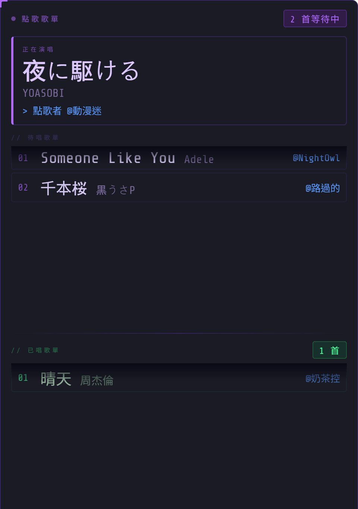
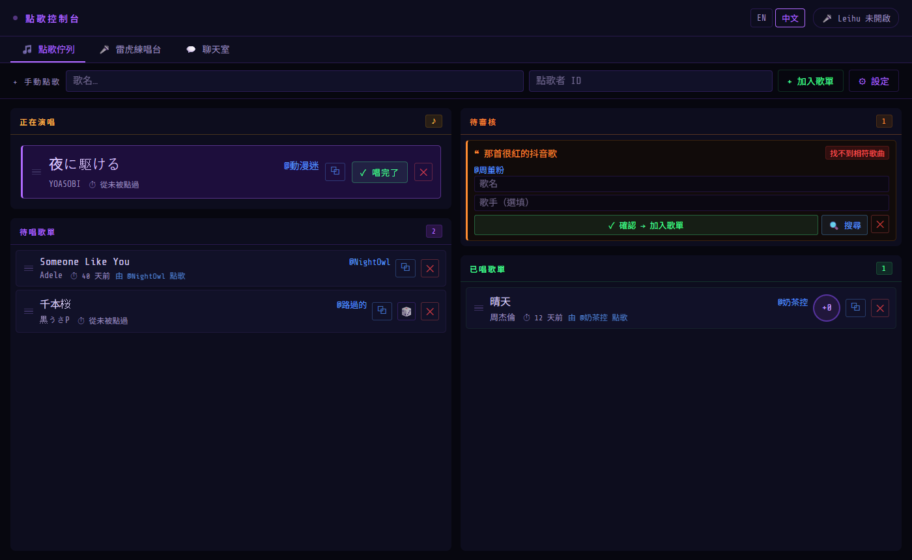
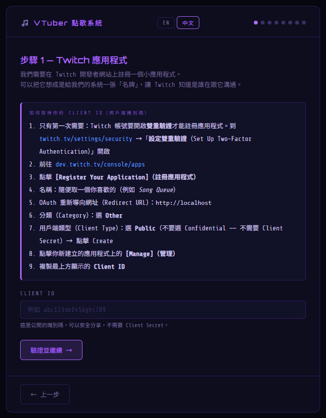
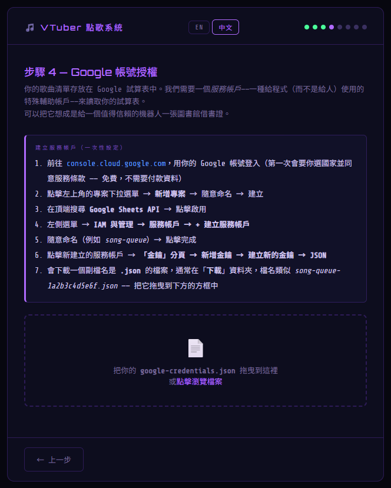
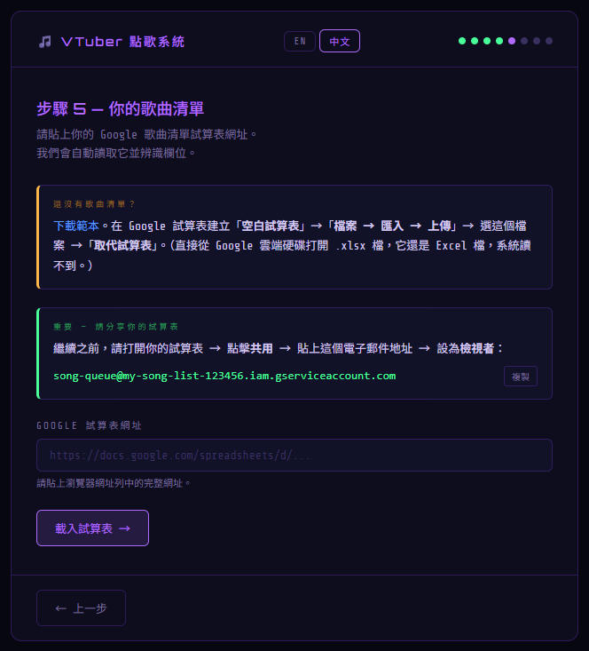
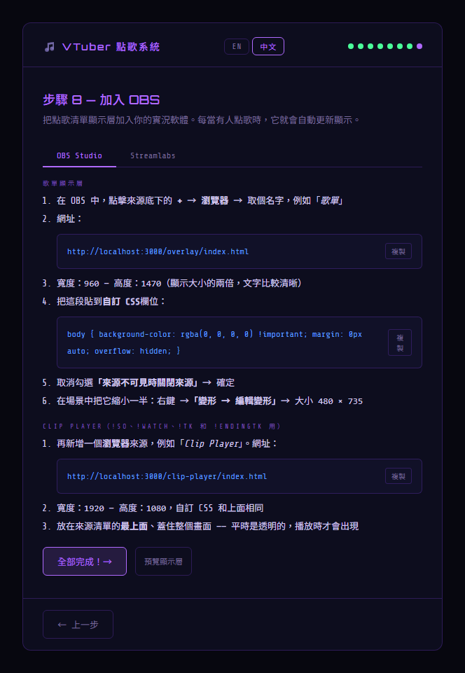
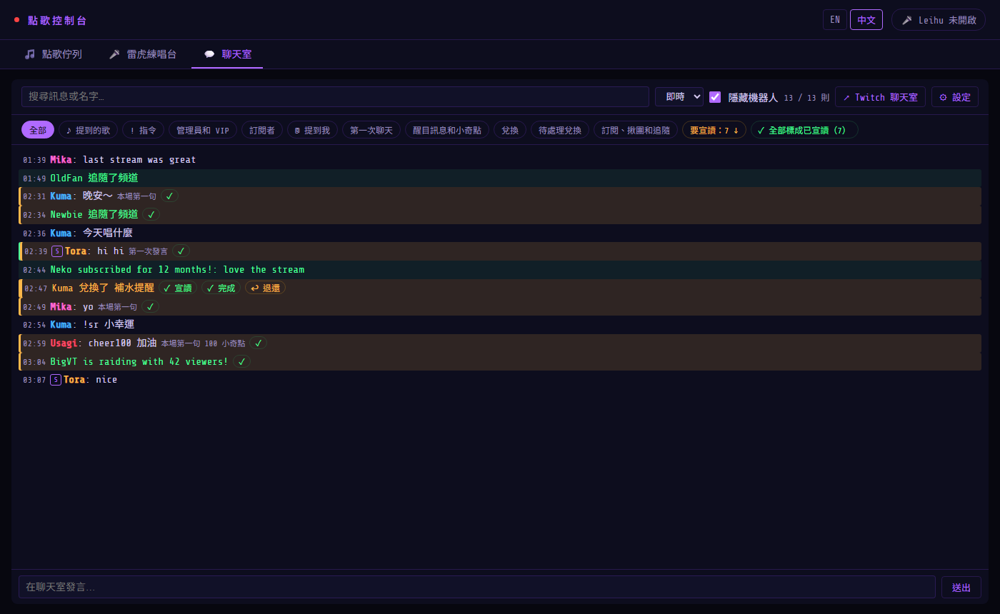

# 🎵 VTuber 點歌系統 — 新手入門（從零開始）

這份指南寫給**完全沒用過**這套系統的實況主：不需要會寫程式、不需要用過命令列，也不需要先有歌單。
照著順序做，大約 **1 小時**就能在直播上用頻道點數點歌。

> English version: [STARTER_GUIDE.md](STARTER_GUIDE.md)

---

## 目錄

1. [這套系統能做什麼](#1-這套系統能做什麼)
2. [開始前要準備的東西](#2-開始前要準備的東西)
3. [開啟 Twitch 雙重驗證](#3-開啟-twitch-雙重驗證)
4. [安裝 Node.js](#4-安裝-nodejs)
5. [下載點歌系統](#5-下載點歌系統)
6. [做你的歌曲清單](#6-做你的歌曲清單)
7. [執行安裝精靈](#7-執行安裝精靈)
8. [把畫面加到 OBS](#8-把畫面加到-obs)
9. [不開台先測試](#9-不開台先測試)
10. [每次直播怎麼用](#10-每次直播怎麼用)
11. [進階功能（選用）](#11-進階功能選用)
12. [更新到新版本](#12-更新到新版本)
13. [遇到問題時](#13-遇到問題時)

---

## 1. 這套系統能做什麼

觀眾用**頻道點數**兌換「點歌券」並輸入歌名，系統會自動在你的歌單裡找到這首歌，加進直播畫面上的歌單。
你在**控制台**按「✓ 唱完了」，下一首就自動跳上來。



- **點歌券**：觀眾打歌名，系統自動比對（打錯字、只打一部分、日文用羅馬拼音都找得到）。比對不確定的會放到「待審核」等你確認。
- **隨機點歌券**：觀眾不用打字，系統從你的歌單隨機挑一首（最近唱過的會避開）。
- **控制台**：管理歌單、看聊天室、處理兌換，全部在一個頁面。
- 全部在**你自己的電腦**上執行，不需要租伺服器，也不用付費。



---

## 2. 開始前要準備的東西

| 需要 | 說明 |
|---|---|
| 一台 **Windows** 電腦 | 就是你開台用的那台 |
| **Twitch 帳號**，頻道有**頻道點數** | 到 [創作者儀表板](https://dashboard.twitch.tv) → 觀眾獎勵 → 頻道點數，看得到管理兌換項目的頁面就可以 |
| 一個 **Google 帳號** | 用來放歌單（Google 試算表）。建議用**個人的 Gmail**，公司或學校的帳號常會被限制 |
| **OBS** 或 **Streamlabs** | 你平常開台用的軟體 |
| 手機 | 開啟 Twitch 雙重驗證時用 |

全部**免費**，不需要信用卡。

---

## 3. 開啟 Twitch 雙重驗證

點歌系統要在 Twitch 註冊一個小程式，而 **Twitch 規定帳號要開啟雙重驗證才能註冊**。已經開過的話跳過這步。

1. 打開 [twitch.tv/settings/security](https://www.twitch.tv/settings/security)（設定 → 安全性與隱私）
2. 找到「**雙重驗證**」→ 按「**設定雙重驗證**」（Set Up Two-Factor Authentication）
3. 照畫面指示用手機完成（簡訊或驗證器 App 都可以）

---

## 4. 安裝 Node.js

Node.js 是點歌系統執行時需要的程式，裝一次就好。

1. 打開 [nodejs.org](https://nodejs.org)，下載標示 **LTS** 的版本（Windows Installer）
2. 執行下載的安裝檔，**全部照預設**一直按「Next」，最後按「Install」
3. 裝完後**重新開機**一次（讓系統認得它）

> 裝的過程中如果出現「Tools for Native Modules」的勾選框，**不用勾**。

---

## 5. 下載點歌系統

1. 下載這個檔案：[**點歌系統 ZIP**](https://github.com/sheng7337/twitch-song-request-system/archive/refs/heads/master.zip)
2. 在下載的 ZIP 檔按**右鍵 → 內容**，如果最下面有「**解除封鎖**」，把它勾起來 → 確定
   （這樣之後執行時 Windows 就不會一直跳出安全性警告）
3. 在 ZIP 檔按右鍵 → **解壓縮全部** → 解壓縮到一個簡單的位置，例如 `C:\SongQueue`（路徑用英文比較保險）

> **不要**放在 OneDrive 同步的資料夾（很多電腦的「桌面」和「文件」會同步到 OneDrive）。
> 這個資料夾之後會存放你的帳號金鑰，不應該上傳到雲端。

解壓縮後的資料夾裡會看到 `start_zh.bat`、`setup` 等檔案，這就對了。

---

## 6. 做你的歌曲清單

歌單放在 **Google 試算表**。系統每 5 分鐘自動讀一次，之後你在試算表加歌，不用重新啟動任何東西。

### 6-1. 用範本建立試算表

1. 下載範本：[**song-list-template.xlsx**](https://github.com/sheng7337/twitch-song-request-system/raw/master/docs/song-list-template.xlsx)
   （解壓縮的資料夾裡也有：`docs\song-list-template.xlsx`）
2. 打開 [sheets.new](https://sheets.new)（會建立一份空白的 Google 試算表）
3. 選單「**檔案 → 匯入**」→「**上傳**」→ 把範本檔案拖進去
4. 「匯入位置」選「**取代試算表**」→ 按「**匯入資料**」
5. 按左上角的「未命名的試算表」，改成你喜歡的名字，例如「我的歌單」

> ⚠ 不要把 .xlsx 檔直接上傳到 Google 雲端硬碟再點開 —— 那樣它還是 **Excel 檔**，系統讀不到。
> 一定要用上面「匯入」的方式。

### 6-2. 歌單的格式

範本裡有 4 個分頁：**國語**、**日語**、**English**、**待練勿點**。每個分頁的第一列是欄位名稱：

| title | artist | key | YTLink |
|---|---|---|---|
| 晴天 | 周杰倫 | 0 | |
| 小幸運 | 田馥甄 | -2 | |
| 夜に駆ける | YOASOBI | | |

- **title**（歌名）和 **artist**（歌手）**：必填**。觀眾點歌時就是比對這兩欄
- **key**（選填）：你唱這首歌的 KEY，相對原調升降幾個半音，例如 `2`、`-3`。會顯示在控制台上提醒你。空白就好
- **YTLink**（選填）：這首歌的 YouTube 連結，搭配「雷虎練唱台」做伴奏時用（見[第 11 章](#11-進階功能選用)）。不用就空著
- **分頁**：照你喜歡的方式分類，名字可以改、可以加新分頁。隨機點歌可以只從某個分頁抽（例如「隨機日語歌」）
- **「待練勿點」分頁**：還在練、不想被點的歌放這裡。**這個名字的分頁不會被點到**，名字請保持一模一樣

範本裡的歌只是例子，**換成你自己的歌**再繼續。

### 6-3. 已經有歌單了？搬過來

- **在 Excel 裡**：用 6-1 的方式匯入你的 Excel 檔，再把欄位整理成「歌名」「歌手」兩欄（欄位名稱不一定要是 title／artist，安裝精靈會讓你點選哪一欄是歌名）
- **歌名和歌手寫在同一格**（例如「晴天 - 周杰倫」）：選取那一欄 →「**資料 → 將文字分割成不同欄**」→ 分隔符選「自訂」→ 輸入 ` - ` → 就會分成兩欄
- **在記事本或文件裡**：整份複製，貼到試算表的 A 欄，一首一列，再用上面的方法分欄
- **在網頁、Notion 的表格裡**：直接複製表格貼到試算表通常就會自動分好欄位

> 一首歌一列。同一首歌不同歌手（翻唱版本）可以分開列，系統會當成兩首歌。

---

## 7. 執行安裝精靈

1. 打開點歌系統的資料夾，**雙擊 `start_zh.bat`**
   - 會出現一個黑色視窗，第一次會花一兩分鐘下載需要的元件（需要網路）
   - 如果跳出「Windows 已保護您的電腦」或安全性警告：按「**其他資訊 → 仍要執行**」或「**執行**」
2. 瀏覽器會自動打開**安裝精靈**。如果沒有，自己打開 <http://localhost:3000>
3. **黑色視窗不要關**：它就是點歌系統本體，關掉就停止了

安裝精靈每一步都有說明，照著做就好。以下是比較容易卡住的地方：

### 步驟 1 — Twitch 應用程式



- 第 1 點的雙重驗證就是[第 3 章](#3-開啟-twitch-雙重驗證)，做過就跳過
- 「OAuth 重新導向網址」填 `http://localhost`，旁邊要按「**Add**（新增）」才會加進去
- 「用戶端類型」一定要選 **Public**
- 按「Create」後，在清單上你的應用程式按「**Manage**（管理）」，最上方的 **Client ID** 複製貼回精靈

### 步驟 2 — 連接你的頻道

按按鈕後會顯示一組代碼，到 **twitch.tv/activate** 輸入，再按「授權」。
**瀏覽器要登入你開台的那個 Twitch 帳號**，不是小帳。

### 步驟 3 — 頻道點數兌換項目

選「**建立新的兌換項目（推薦）**」，取名字、設定點數就好（例如點歌券 500 點、隨機點歌券 300 點）。之後可以在 Twitch 上再改點數。

### 步驟 4 — Google 帳號授權



這一步要在 Google Cloud 建立一個「服務帳戶」—— 一個給程式用的小帳號，專門讀你的歌單。看起來很專業，但照著點就好，**全部免費**：

- 第一次打開 Google Cloud 會要你選國家、同意條款，照做就好，**不需要付款資料**
- 建立專案時，「機構」那欄維持「**無機構**」
- 建立服務帳戶時，第 2、3 步（授予存取權）都是**選填**，直接按「**完成**」
- 「金鑰 → 新增金鑰 → 建立新的金鑰 → **JSON** → 建立」之後，瀏覽器會下載一個 `.json` 檔，通常在「**下載**」資料夾
- 把那個檔案**拖曳**到精靈的方框裡

> 這個 .json 檔就像鑰匙，**不要傳給別人**，也不要上傳到網路。

### 步驟 5 — 你的歌曲清單



1. 回到你在[第 6 章](#6-做你的歌曲清單)做的 Google 試算表
2. 按右上角「**共用**」→ 貼上精靈顯示的電子郵件（結尾是 `iam.gserviceaccount.com`）→ 權限選「**檢視者**」
3. 取消勾選「**通知使用者**」→ 按「共用」（這個帳號收不到信，不取消會跳警告）
4. 複製試算表的網址（瀏覽器網址列的整串），貼回精靈 → 「載入試算表」
5. 精靈會顯示前幾列，**點選哪一欄是歌名、哪一欄是歌手**（KEY 欄選填）

### 步驟 6、7 — 選用

- **分頁隨機點歌券**：想要「隨機日語歌」這種只從某個分頁抽的兌換項目就加，不需要就跳過
- **點歌紀錄**：記錄每首歌被點幾次、誰點的，控制台會顯示「上次點是幾天前」。建議開，用 [sheets.new](https://sheets.new) 建一份新的空白試算表，共用給同一個電子郵件，**這次要選「編輯者」**

### 步驟 8 — 加到 OBS

見下一章。

---

## 8. 把畫面加到 OBS



要加**兩個**瀏覽器來源：

**① 歌單顯示層**（觀眾看到的歌單）

1. OBS 的「來源」底下按 **+** →「**瀏覽器**」→ 取名「歌單」
2. 網址：`http://localhost:3000/overlay/index.html`
3. 寬度 `960`、高度 `1470`
4. 「自訂 CSS」整段換成：
   ```css
   body { background-color: rgba(0, 0, 0, 0) !important; margin: 0px auto; overflow: hidden; }
   ```
5. 取消勾選「**來源不可見時關閉來源**」→ 確定
6. 在場景中把它縮小一半：右鍵 →「變形 → 編輯變形」→ 大小 `480 × 735`，再拖到你想放的位置

**② Clip Player**（`!so` 播 Clip、`!tk` 感謝名單等指令用）

1. 再加一個「瀏覽器」來源，取名「Clip Player」
2. 網址：`http://localhost:3000/clip-player/index.html`，寬 `1920`、高 `1080`，自訂 CSS 同上
3. 放在來源清單的**最上面**、蓋住整個畫面。平時是透明的，有東西播放時才會出現

> 歌單顯示層的語言（中文／English）在控制台「點歌佇列」分頁的「⚙ 設定 → 疊加層語言」切換。

---

## 9. 不開台先測試

1. 確認黑色視窗開著
2. 在**控制台**最上面的「**+ 手動點歌**」輸入一首你歌單裡的歌、點歌者隨便打 → 按「**+ 加入歌單**」
3. 看 OBS 的歌單顯示層有沒有出現這首歌
4. 按「**✓ 唱完了**」，歌會移到「已唱歌單」

想測試真的兌換：請朋友或用小帳到你的頻道兌換「點歌券」，打一個歌名。幾秒內就會出現在控制台。

---

## 10. 每次直播怎麼用

**開台前**：雙擊 `start_zh.bat`。控制台會自動開在**自己的視窗**，就這樣。

**直播中**：

| 你想做的事 | 怎麼做 |
|---|---|
| 唱完一首 | 「正在演唱」的「**✓ 唱完了**」，下一首自動跳上來 |
| 調整順序 | 直接**拖曳**歌曲卡片 |
| 不想唱這首 | 按 **✕** 移除（點歌券建立在點歌系統的話，點數會自動退還） |
| 處理「待審核」 | 系統不確定的點歌放在這裡。改好歌名按「**✓ 確認 → 加入歌單**」，或按 ✕ 拒絕 |
| 隨機點到不想唱的 | 按 🎲 重新抽一首 |
| 看聊天室、感謝觀眾 | 「**聊天室**」分頁：訂閱、揪團、追隨、兌換、第一次聊天等會用橘色標示，宣讀後按 ✓。按「**要宣讀：N ↓**」跳到下一則 |



**版主可以在聊天室用的指令**（觀眾不能用）：

| 指令 | 作用 |
|---|---|
| `!so 帳號` | 送出 Twitch 的 Shoutout，播放那個頻道的隨機 Clip，並加入感謝名單 |
| `!tk` | 播放日本電視風格的感謝名單（本場所有 `!so` 過的頻道） |
| `!endingtk` | 片尾感謝名單：揪團、訂閱、小奇點、追隨、兌換、點歌和最活躍的聊天觀眾 |
| `!watch 網址` | 播放 Twitch Clip、YouTube 或影片連結 |
| `!replay` / `!stop` | 重播上一段／立即停止 |

**下播後**：關掉黑色視窗就好。

---

## 11. 進階功能（選用）

- **雷虎練唱台**（[Leihu Singsing](https://github.com/LeihuTW/Leihu-singsing)）：另一個免費程式，把 YouTube 影片做成去人聲伴奏和歌詞，可以調 KEY。裝在同一台電腦就會自動連上，控制台的「雷虎練唱台」分頁就會顯示它。試算表的 **YTLink** 欄就是給它用的：「雷虎練唱台」分頁的「⚙ 設定」→「① 幫每首歌找 YouTube 連結」→「🔗 找 YouTube 連結」可以自動幫你填
- **在聊天室發言、禁言／封鎖／Shoutout／揪團／置頂（點觀眾的名字）、完成或退還兌換、把在 Twitch 建立的兌換項目交給系統管理** —— 見 [SETUP_zh_TW.md](../SETUP_zh_TW.md) 的「聊天室分頁」
- **模式（🎤 唱歌／💬 聊天／☕ 休息）：按一下切換 Streamlabs Desktop 或 OBS 的場景、顯示項目和音訊，並暫停 Clip、在聊天室發言** —— 見 [SETUP_zh_TW.md](../SETUP_zh_TW.md) 的「模式」
- 完整功能說明：[SETUP_zh_TW.md](../SETUP_zh_TW.md)

---

## 12. 更新到新版本

1. 關掉黑色視窗
2. 用[第 5 章](#5-下載點歌系統)的連結下載新的 ZIP，一樣先「解除封鎖」再解壓縮
3. 打開解壓縮出來的資料夾（名字是 `twitch-song-request-system-master`），**全選裡面的東西 → 複製**
4. 貼到你原本的點歌系統資料夾 → 選「**取代目的地中的檔案**」

你的設定（`.env`）、Google 金鑰和歌單紀錄不在 ZIP 裡，所以**不會被覆蓋**。之後照常雙擊 `start_zh.bat`。

---

## 13. 遇到問題時

| 狀況 | 解決方法 |
|---|---|
| 黑色視窗說「**找不到 Node.js**」 | 回到[第 4 章](#4-安裝-nodejs)安裝，裝完要**重新開機** |
| 瀏覽器沒有自動打開 | 自己打開 <http://localhost:3000> |
| 出現「**EADDRINUSE**」或 3000 被占用 | 點歌系統已經開著了（可能在另一個黑色視窗），先把舊的關掉 |
| Twitch 開發者網站不讓我註冊應用程式 | 先開啟[雙重驗證](#3-開啟-twitch-雙重驗證) |
| 精靈說 Client ID 無效 | 回 Twitch 開發者網站的應用程式「Manage」頁重新複製，前後不要多空白 |
| 授權代碼過期 | 在精靈重新按一次按鈕，30 分鐘內完成 |
| Google 說**無法建立金鑰**（服務帳戶金鑰建立已停用） | 你用的是公司或學校帳號，被管理員限制了。改用**個人 Gmail** 從頭建立 |
| 精靈說「存取被拒」 | 試算表還沒「共用」給服務帳戶的電子郵件，見[步驟 5](#步驟-5--你的歌曲清單) |
| 精靈說「這是 Excel 檔」 | 用[第 6 章](#6-1-用範本建立試算表)「匯入」的方式重做，或在試算表選「檔案 → 儲存為 Google 試算表」 |
| 精靈說「還沒啟用 Google Sheets API」 | Google Cloud 上方搜尋「Google Sheets API」→「啟用」，等一分鐘再試 |
| 步驟 3 看不到兌換項目、也不能建立 | 你的頻道還沒有頻道點數，見[第 2 章](#2-開始前要準備的東西) |
| OBS 的歌單是空的或沒更新 | 黑色視窗有沒有開著？在 OBS 對來源按兩下打開內容 →「**重新整理目前頁面的快取**」 |
| 觀眾兌換了但沒出現 | 黑色視窗有沒有開著？兌換的是不是精靈裡選的那個點歌券？ |
| 觀眾點的歌一直進「待審核」 | 那首歌可能不在你的歌單，或名字差很多。加到試算表後 5 分鐘內就會生效 |
| 版主打指令沒反應 | 只有版主和你本人能用；Clip Player 來源要加到 OBS 才看得到 |

還是解決不了？到 [GitHub 的 Issues](https://github.com/sheng7337/twitch-song-request-system/issues) 留言，附上黑色視窗裡的錯誤訊息（**不要**貼 `.env` 或 .json 金鑰的內容）。
